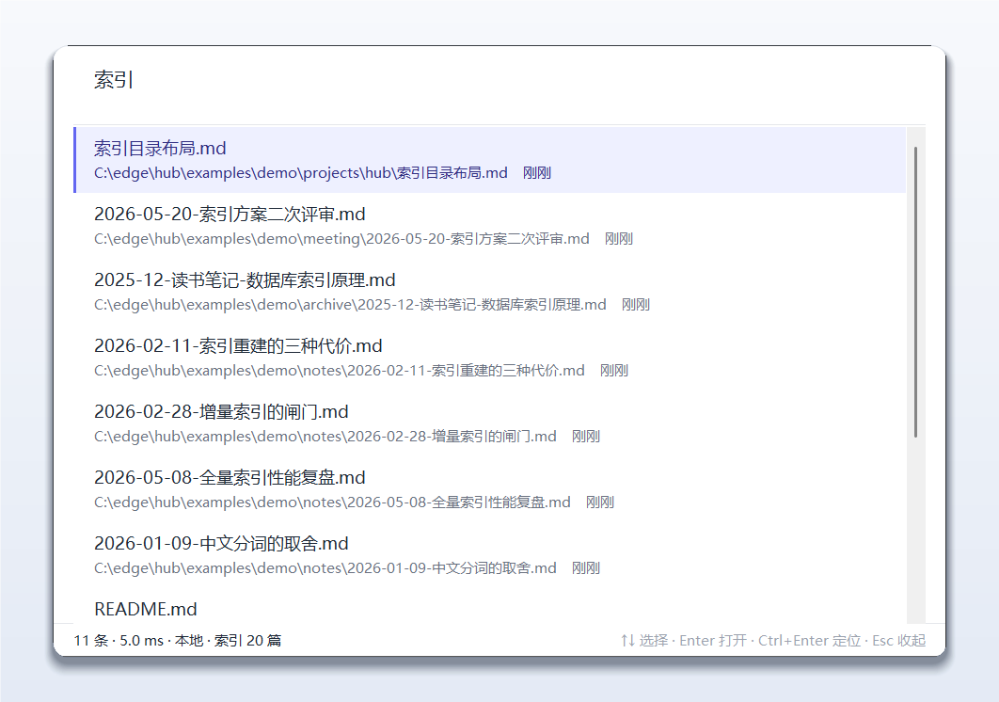
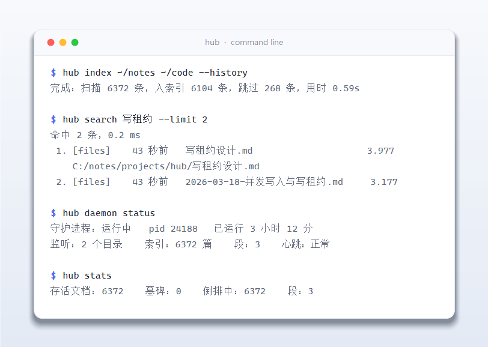
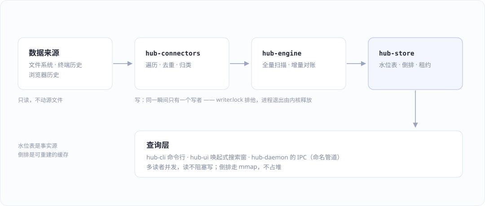

<p align="center">
  
</p>

<p align="center">
  <a href="#快速上手"><b>快速上手</b></a> ·
  <a href="#命令行">命令行</a> ·
  <a href="#界面">界面</a> ·
  <a href="#架构">架构</a> ·
  <a href="#实测数据">实测数据</a> ·
  <a href="#隐私与清理">隐私与清理</a>
</p>

<p align="center">
  
  
  
  
  
</p>

<p align="center">
  <code>Ctrl+Alt+Space</code> 唤出 · 6000 篇文档 · 1.5 毫秒 · 常驻 13 MB · 一个 exe · 全程离线
</p>



---

## 它解决什么问题

真正想找回一条信息时，通常只记得"大概长什么样"：

- 三天前在终端里敲过一行能跑的命令，现在只记得几个关键词
- 上个月写在某个 `.md` 里的一段设计，忘了在哪个目录
- 上周翻过的某个页面、某个文件里的一句话

系统搜索慢、不支持"上个月"这种说法、更不会去翻你的终端历史。
hub 把**文件系统、终端历史、浏览器历史**收进同一个本地索引，
然后用一句话把它们找回来：

```bash
hub search 上个月写的那个内存泄漏的笔记
hub search 零拷贝 "mmap"  -malloc        # 精确短语 + 排除词
hub search 命令  docker compose          # 只在终端历史里找
```

全程离线：没有账号、没有网络请求、没有遥测。数据只在你自己盘上。

---

## 特点

| 能力 | 说明 |
|---|---|
| **改完即搜** | daemon 常驻监听，改一个文件约 1 秒后可搜到，不用敲任何命令 |
| **毫秒级** | 倒排走 `mmap` 不进堆，6372 篇文档 1.5 ms 出结果 |
| **省内存** | 常驻私有提交 9–13 MB；索引大小不直接影响常驻内存 |
| **多源统一** | 文件 / 终端历史 / 浏览器历史 一套查询语法、一套排序 |
| **一个 exe** | 无服务、无安装包、无运行时依赖；数据全在 `~/.hub` |
| **唤出即用** | 全局热键 + 托盘图标，无边框浮层，不占任务栏也不进 Alt+Tab |
| **中文优先** | 中文分词、`上个月` / `三个月前` 这类时间表达、中文输入法原生支持 |
| **给脚本和 AI 用** | 输出是稳定的纯文本，一条命令定位到路径，不用遍历目录 |

### 为什么它对 AI 友好

让 AI 找"我上周写的那个东西"，最贵的不是思考，是**把上下文塞满**：
遍历目录、读一堆文件、再截断。hub 把这一步压缩成一次调用 ——

```bash
hub search "写租约" --limit 3
```

```
命中 2 条，0.2 ms

 1. [files   ]    43 秒前  写租约设计.md                                3.977
    C:/edge/hub/examples/demo/projects/hub/写租约设计.md
 2. [files   ]    43 秒前  2026-03-18-并发写入与写租约.md                  3.177
    C:/edge/hub/examples/demo/notes/2026-03-18-并发写入与写租约.md
```

拿到路径之后才决定读哪一篇、读多少。检索本身是 0.2 ms，代价基本为零。

---

## 快速上手

**环境**：Windows 10/11 + Rust ≥ 1.89 + MSVC 生成工具。不需要管理员权限。

```bash
git clone <this-repo> hub && cd hub
cargo build --release      # 首次 2–5 分钟（Tantivy + bundled SQLite）
cargo test                 # 142 条测试，全部离线可跑
```

### 先拿样例库试一下

仓库里有 20 篇演示笔记（`examples/demo`），索引到临时目录，不碰你的真实数据：

```bash
./target/release/hub --data ./demo-data index examples/demo
./target/release/hub --data ./demo-data search 索引
./target/release/hub --data ./demo-data ui          # 敲 Ctrl+Alt+Space 唤出，Esc 收起
```

### 正式使用

```bash
# 1. 起后台：首次把目录记进配置，之后可省略目录直接 start
./target/release/hub daemon start ~/code ~/notes --history --autostart

# 2. 装搜索窗：登录后自动起来，只等热键、不先弹窗
./target/release/hub ui install

# 3. 用
./target/release/hub search 上个月写的那个内存泄漏的笔记
```

`--autostart` 只是顺手装一下开机自启，等价于事后单独执行 `hub daemon install`；
`hub ui install` 是**另一个**注册表值，两者互不覆盖。

不想常驻也能手动扫（增量，内容没变的直接跳过）：

```bash
./target/release/hub index ~/code ~/notes --history
./target/release/hub stats
```

### 数据目录

默认 `~/.hub`，可用 `HUB_HOME` 或 `--data <dir>` 覆盖：

```
~/.hub/
├── meta.sqlite      水位表：content_hash / mtime / tombstone / doc_id（事实源）
├── index/           Tantivy 倒排（可重建，删了不心疼）
├── daemon.conf      监听哪些目录、debounce / 对账 / 合并 / 历史轮询间隔
├── daemon.state     pid / 心跳 / 段数 / 累计统计
├── daemon.log       后台日志（5 MB 滚动）
├── writer.lock      写租约的锁（0 字节，内核保证进程一死就释放）
└── writer.owner     「现在是谁在写」，只在有人持锁时存在
```

---

## 命令行



| 命令 | 作用 |
|---|---|
| `hub search <查询> [--limit N] [--local]` | 检索。daemon 在跑时直接问它；`--local` 强制自己开索引 |
| `hub daemon start [目录]... [--history] [--autostart]` | 起后台，之后改文件自动进索引 |
| `hub daemon status` | 在不在跑、IPC 通不通、监听了什么、干了多少活 |
| `hub daemon stop [--force]` | 优雅停止（先把攒着的变更写完） |
| `hub daemon log -n 50` | 看后台日志 |
| `hub ui [--hotkey ctrl+alt+space] [--hidden] [--detach]` | 唤起式搜索窗 |
| `hub ui install` / `uninstall` / `status` | 搜索窗的开机自启 |
| `hub index <目录>... [--history] [--max-mb N]` | 手动全量扫描（daemon 在跑时通常不需要） |
| `hub stats` | 索引规模与来源分布（daemon 在跑时数字是实时的） |
| `hub merge` | 回收已删文档占用的倒排空间 |
| `hub reset --yes` | 清空索引与水位表（破坏性，要求 daemon 已停） |

### 查询语法

| 能力 | 例子 |
|---|---|
| 时间 | `上个月`、`三个月前`、`3 天前`、`十二个月前` |
| 来源提示 | `代码片段` → 文件、`命令` → 终端历史 |
| 显式来源 | `source:terminal xxx`、`in:code` |
| 精确短语 | `内存 "零拷贝"`（能**引入**文档，不只是提权） |
| 排除 | `-malloc`（大小写不敏感） |

排序：BM25（词级 1.0 / 二元 0.6 双通道）→ 短语加成 → 排除 → 时间惩罚 → 来源过滤 → 时间衰减。

---

## 界面

```bash
hub ui                      # 前台跑
hub ui --detach             # 丢到后台，关掉终端也不影响
hub ui --hotkey ctrl+alt+j  # 默认组合被别的软件占了时换一个
hub ui install              # 登录时自动起来
```

窗口是无边框浮层，**不占任务栏、也不进 Alt+Tab**。再执行一次 `hub ui` 不会开出第二个窗口，
而是把已有的叫到前面。正因为没有任务栏按钮，托盘里留了一个图标（靛蓝放大镜）：
左键唤出，右键「打开搜索窗 / 快捷键 / 索引状态 / 退出」。

| 键 | 行为 |
|---|---|
| `↑` `↓` / `PgUp` `PgDn` | 选结果 |
| `Enter` | 用系统默认程序打开 |
| `Ctrl+Enter` | 在资源管理器里定位 |
| `Ctrl+Shift+C` | 复制路径（不抢 `Ctrl+C`） |
| `Esc` | 收起 |

底部状态栏会写清楚这次查询走的是哪条路：

```
27 条 · 5.1 ms · 实时 · 索引 6371 篇     ← daemon 在跑，走 IPC，新提交立刻可见
13 条 · 8.3 ms · 本地 · 索引 6371 篇     ← daemon 没在跑，界面自己开索引
```

> 为什么是 Win32 原生控件而不是 egui：中文输入法。IME 在自绘窗口上要自己接
> `WM_IME_COMPOSITION`、自己画候选窗、自己算光标位置；`Edit` 控件这些全是现成的。
> 代价是界面只有 Windows 版 —— 这也正是它零第三方 UI 依赖的原因。

---

## 架构



```
hub-cli         参数 / IO / 打印，不含检索逻辑也不含采集逻辑
hub-ui          唤起式搜索窗 + 托盘图标（Win32 原生控件，零第三方依赖，仅 Windows）
hub-daemon      常驻进程：watcher + debounce + 对账 + 空闲合并 + 历史轮询 + 自启 + IPC
hub-engine      采集流水线（scan_all / index_paths / remove_paths / reconcile）
hub-store       MetaStore(SQLite) + HubIndex(Tantivy) + Indexer(胶水) + lease(写租约)
hub-core        查询解析 / 中文分词 / BM25 / tombstone（零依赖）
hub-connectors  files / terminal 采集器（零依赖）
```

**五条不可违背的边界**

1. **SQLite 是事实源，Tantivy 是能重建的缓存。** 索引删了能重建，元数据删了就真丢了。
2. **`parse_query` 是语义的唯一入口。** 索引层不许自己解析字符串 —— 第一版就是把原始
   字符串丢给 Tantivy 的 `QueryParser`，「上个月」「代码片段」「-排除」一个都没生效，
   而测试照样全绿。
3. **分词必须同源。** 索引与查询走同一套 `word_tokens` / `bigram_tokens`。
   一边用 jieba、一边用自研词典，切出来的词对不上，会变成"能建索引但搜不到"，且不报错。
4. **采集只有一条路径。** `hub index` 和 daemon 都只能通过 `hub-engine` 写数据。
   两条路径各写一遍"怎么遍历、怎么判重"，行为必然分叉。
5. **同一瞬间只有一个写者。** 任何写索引或水位表的路径都必须先拿写租约
   （`hub-store::lease`，操作系统文件锁）。Tantivy 的写入器锁是硬互斥的，
   省掉这一步就等于把"两个写者撞上"变成一条随机出现的 `Failed to acquire index lock`。

> 开发过程中踩过的具体坑（Tantivy API 变更、Windows 文件监听、托盘图标、IME、
> WAL 并发打开……）都记在 [`docs/PITFALLS.md`](docs/PITFALLS.md)。那里的每一条
> 都对应一个已经修掉的 bug 和一条钉住它的测试。

---

## 实测数据

**速度**（Windows，release 构建，6372 篇真实语料）

| 动作 | 结果 |
|---|---|
| 全量索引 6372 篇 | 0.59 s |
| 单次查询 | 0.5–5 ms |
| 改一个文件 → 可搜到 | 约 1 s（debounce 800 ms） |
| 二次索引（增量） | 0.01 s，全部跳过 |

**内存**（同一份语料，两个口径）

| 场景 | 工作集 | 私有提交 |
|---|---|---|
| daemon 空闲 | 19.9 MB | **7.0 MB** |
| 搜索窗（隐藏等热键 / 出结果） | 18.0 / 23.5 MB | **2.4 / 2.9 MB** |
| `hub search`（本地 / 经 daemon） | 峰值 18–19 / 16 MB | 峰值 4.7–5.3 / **2.1 MB** |
| 全量索引 6372 篇（一次性） | 峰值 50.5 MB | 峰值 45.1 MB |

常驻合计：**私有提交 9.4–13 MB，工作集 42–48 MB**。差在映射的文件页上
（exe 与系统 DLL 映像、索引段文件页），这部分系统随时能回收。
所以"占 45 MB"是最坏口径，"占 10 MB"才是真正挤占别人的部分 —— 两个都真，说清才不算撒谎。

---

## 隐私与清理

**不联网。** 没有 HTTP 客户端、没有账号、没有遥测，代码里不存在任何上传路径。

**注意索引里存了正文。** 为了能出摘要和命中片段，`title` / `body` 是 `STORED` 的，
所以 `<数据目录>` 本身属于敏感数据：**不要**把它提交到仓库、打包分享，或贴进 issue。

想清掉，三档由浅到深：

```bash
hub reset --yes          # 清索引与水位表（原始文件不受影响）
rm -rf ~/.hub            # 连配置、日志、锁一起删干净
hub daemon uninstall     # 取消 daemon 开机自启
hub ui uninstall         # 取消搜索窗开机自启
```

自启只是 `HKCU\Software\Microsoft\Windows\CurrentVersion\Run` 下的两个值
（`HubDaemon` / `HubUi`），不需要管理员权限，任务管理器「启动」标签里也能临时禁用。

---

## 仓库结构

```
crates/
  hub-core/         查询解析、分词、BM25 打分、时间表达        （零依赖）
  hub-connectors/   files / terminal 采集器                    （零依赖）
  hub-store/        SQLite 水位表 + Tantivy 倒排 + 写租约
  hub-engine/       采集流水线：扫描、增量对账、删除
  hub-daemon/       常驻进程、文件监听、IPC、开机自启
  hub-cli/          命令行入口
  hub-ui/           Win32 搜索窗 + 托盘                  （仅 Windows）
docs/
  images/           README 用图
  ENGINEERING.md    后台更新 / IPC / 写租约的完整说明
  PITFALLS.md       踩坑清单（每条都对应一个修掉的 bug）
examples/demo/      20 篇演示笔记，用来试跑
RUNBOOK.md          从装工具链到排错的完整步骤
软件设计文档.md      设计取舍、缺陷表、实测记录
```

## 文档

| 想知道 | 看 |
|---|---|
| 怎么装、怎么跑、出问题怎么办 | [`RUNBOOK.md`](RUNBOOK.md) |
| 监听、对账、IPC、写租约的完整说明 | [`docs/ENGINEERING.md`](docs/ENGINEERING.md) |
| 为什么这么设计、踩过什么坑 | [`软件设计文档.md`](软件设计文档.md) |
| 哪些"想当然"是错的 | [`docs/PITFALLS.md`](docs/PITFALLS.md) |

## 已知边界

- **界面只有 Windows 版**：Win32 原生控件（为了中文输入法），Linux/macOS 没做
- **开机自启只实现 Windows**：macOS 需 `launchd`、Linux 需 `systemd`，没有做
- **没有截图 OCR、聊天记录 connector**
- **非 UTF-8 文件直接跳过**（GBK 会变乱码，宁可漏不要脏）
- **终端历史每 5 秒轮询**（不是事件监听）：敲完命令到能搜到最多差 5 秒
- **目录重命名当成"删 + 增"**：内容没变也要重新分词，正确但有开销
- **托盘图标在 Win11 默认被收进折叠区**：系统行为，拖出来一次就常驻（没有 API 能代劳）
- **`hub reset` 要求先停 daemon**：Windows 上被 mmap 的段文件删不掉

## 下一步

```
1. 截图 OCR / 聊天记录 connector
2. Linux / macOS 版界面（IME 在 GTK/Qt 上是现成的，成本比 Windows 低）
3. Linux（PSS）/ macOS（Private Memory）的内存基准 —— 现在只有 Windows 有数
```
